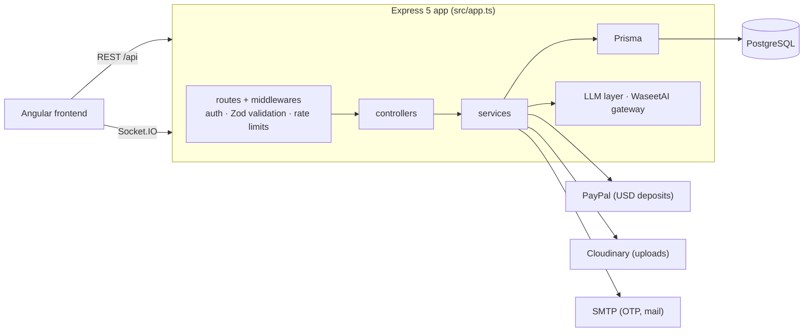

<div align="center">


**REST + WebSocket API behind the Waseet AI services marketplace: accounts, requests, contracts, wallet and admin operations.**

[](https://nodejs.org)
[](https://www.typescriptlang.org)
[](https://expressjs.com)
[](https://www.prisma.io)
[](https://www.postgresql.org)

[Quick start](#quick-start) · [Database](#database) · [Scripts](#scripts) · [API](#api-and-health) · [Docs](#documentation) · [Frontend repo](https://github.com/Amr546214/waaseetai_Front)

</div>

---

## Overview

This repository is the single backend for Waseet AI. It owns authentication and sessions, the client → proposal → contract → escrow/delivery workflow, the marketplace and cart, wallet deposits and withdrawals, disputes and reviews, notifications, real-time chat, the marketing/affiliate program, admin operations, and the AI-assisted features. The [frontend](https://github.com/Amr546214/waaseetai_Front) is the only first-party client.



## Tech stack

| Area | Technology |
|---|---|
| Runtime / language | Node.js 22, TypeScript 6 (`strict`) |
| HTTP / realtime | Express 5, Socket.IO 4 |
| Data | PostgreSQL 16, Prisma 7 with the `pg` driver adapter (`prisma/schema.prisma`) |
| Validation / security | Zod 4, `helmet`, `cors` allowlist, `express-rate-limit`, JWT + `bcrypt` |
| Integrations | PayPal, Cloudinary, SMTP (Nodemailer), Google sign-in, LLM provider (`gemini` or `waseet`) |
| API docs | Generated OpenAPI + `swagger-ui-express` |
| Tests | Node built-in runner (`node:test`) through `tsx` |
| Containers | Docker (multi-stage), Docker Compose |

## Quick start

**Requirements:** Node.js 22, npm, PostgreSQL 16 (local, or the Compose service below). Cloudinary, PayPal sandbox and LLM keys are optional unless you exercise those features.

```bash
git clone https://github.com/Amr546214/waaseetai_Back.git
cd waaseetai_Back
npm ci
cp .env.example .env        # then replace every placeholder; never commit .env
# set at least DATABASE_URL, JWT_SECRET, OTP_SECRET, FRONTEND_URL, CORS_ORIGINS
npm run prisma:generate
npx prisma db push          # fresh database only — see "Database" below
npm run db:seed             # optional: creates a SUPER_ADMIN from SEED_ADMIN_EMAIL / SEED_ADMIN_PASSWORD
npm start                   # nodemon + tsx on http://localhost:5009
curl http://localhost:5009/health
```

`npm run seed:taxonomy` loads categories and specialties.

<sub>Verified on 2026-10-28 against a throwaway local PostgreSQL 16 container: `prisma generate`, `prisma db push` (83 tables), `db:seed`, `npm start`, `/health`, `/api/openapi.json` all worked with only the variables listed above. Docker Compose, uploads, PayPal, SMTP and LLM paths were not exercised.</sub>

**Docker:** `docker compose up -d --build` starts PostgreSQL 16 and the API (production image). The container never changes the schema unless you opt in with `RUN_DB_PUSH=true` or `RUN_DB_MIGRATIONS=true` in `.env`.

## Database

> **Known limitation — do not run `npm run db:migrate` or `prisma migrate deploy` on an empty database.** The historical migration chain is not safe for a fresh database: later migrations reference objects missing from the initial one ([DEPLOYMENT.md](DEPLOYMENT.md)).

| Situation | What to do |
|---|---|
| New, empty local database | `npx prisma db push` (add `RUN_DB_PUSH=true` for Docker) |
| Database whose history is already tracked | `npm run prisma:migrate:deploy` (`RUN_DB_MIGRATIONS=true` for Docker) |
| Production or shared servers | Follow [DEPLOYMENT.md](DEPLOYMENT.md) and [docs/prod-deploy-checklist.md](docs/prod-deploy-checklist.md); take a backup first |

**Verified:** on an empty PostgreSQL 16, `prisma migrate deploy` fails (`type "ContractStatus" does not exist`) while `prisma db push` succeeds.

Review any SQL under `docs/` marked *NOT EXECUTED* before applying it; those files are prepared plans, not applied changes. Browse data with `npm run db:studio`.

## Scripts

| Script | Purpose |
|---|---|
| `npm start` | Dev server (`prestart` runs `prisma generate`, then `nodemon src/app.ts`) |
| `npm run build` / `npm run start:prod` | Compile to `dist/` / run `dist/app.js` |
| `npm test` | Whole test suite (`tsx --test`, colocated `*.test.ts`) |
| `npm run prisma:generate` | Generate the Prisma client |
| `npm run prisma:migrate:deploy` | Apply tracked migrations (not for fresh databases) |
| `npm run db:seed` · `db:seed:e2e` · `seed:taxonomy` | Admin account · manual-QA data · taxonomy |
| `npm run db:studio` | Prisma Studio |

**Tests:** most suites mock Prisma and I/O (`--experimental-test-module-mocks`) and need no database. Some open loopback listeners, and the `*.pg.test.ts` suites need an isolated local PostgreSQL (`QA_ISOLATED_PG_URL`, see the header of each file) — they are skipped when it is not set. There is no CI-integrated E2E layer. The full suite was not run for this documentation change.

## API and health

| Endpoint | Notes |
|---|---|
| `GET /health` · `GET /api/health` | Unauthenticated liveness probe; does not query the database |
| `GET /api/docs` · `GET /api/openapi.json` | Swagger UI and OpenAPI JSON, generated from the registered Express routes at startup |

Use the `/api/...` paths; routers are also mounted without the prefix to support different proxy setups. Responses follow `{ success, data }` / `{ success, message }`. No public hosted Swagger URL is documented in this repository.

## Auth, roles and integrations

- **Auth:** email/password with OTP verification, Google sign-in, JWT bearer tokens validated against a server-side session record (revocable); Socket.IO uses the same check.
- **Roles:** through `/switch-active-role` a user can hold and switch `CLIENT`, `PROVIDER` and `AFFILIATE`; the account-management service deliberately excludes `ADMIN` and `SUPER_ADMIN`. Admin accounts come from the seed script, and admin routes (e.g. `/admin/users/:id/roles`) are guarded separately.
- **Payments:** wallet deposits through PayPal (USD only); payout automation and the affiliate commission engine are flag-gated and default to off.
- **AI:** an in-house LLM layer (`LLM_*`; answers `503 NOT_CONFIGURED` when unset) and a WaseetAI gateway (`WASEET_AI_*`; the help assistant and AI-review sockets report "not configured"). Other features are ordinary application code.
- **Secrets:** environment variables only. `.env.example` (local) and `.env.production.example` (VPS) hold placeholders.

## Documentation

| Document | Contents |
|---|---|
| [docs/backend-guide.md](docs/backend-guide.md) | Features, roles, structure, data model, auth, security, known limitations |
| [DEPLOYMENT.md](DEPLOYMENT.md) | VPS deployment with Docker Compose and Nginx (`deploy/nginx/`) |
| [docs/prod-deploy-checklist.md](docs/prod-deploy-checklist.md) | Production checklist (Arabic) |
| [docs/notifications-event-matrix.md](docs/notifications-event-matrix.md) | Notification events |
| [docs/proposals/](docs/proposals) | Design proposals (rate-limit tiers, amendments, disputes) |
| [Frontend repository](https://github.com/Amr546214/waaseetai_Front) | Angular client |
